<!-- header:start -->
<div align="center">


<a href="#-quick-start"></a>

<a href="LICENSE"></a>

<a href="https://github.com/ajendras/apkmorph/stargazers"></a>
<a href="https://github.com/ajendras/apkmorph/actions/workflows/ci.yml"></a>

<a href="CONTRIBUTING.md"></a>

**Natural-language AI tool that analyzes APKs and generates intelligent patches from plain-English descriptions**

[✨ Features](#-features) • [⚡ Quick start](#-quick-start) • [🧰 Usage](#-usage) • [🧩 Architecture](#-architecture) • [📍 Roadmap](#-roadmap) • [🤝 Contributing](#-contributing)

</div>
<!-- header:end -->

## ✨ Why APK Morph?

Power users and indie Android devs waste hours manually editing Smali to customize apps or remove bloat. Existing patchers are opaque and lack explanation. APK Morph fills the gap with a clean local-LLM interface that translates plain-English intent into precise, auditable changes while keeping everything offline.

- Natural-language requests like “disable all analytics” are turned into minimal, targeted Smali/XML edits
- Every change ships with a plain-English rationale, confidence score, and before/after diff
- Fully local: no data leaves your machine; works with any Ollama model and optional GPU
- One-click rebuild, zipalign, and signing (debug or custom keystore) produces a ready-to-install APK
- Supports popular local models (Gemma 2, Phi 3, Code Llama) with automatic download on first use

## 🎬 Demo

<p align="center"></p>

## 🚀 Features

<table>
<tr>
<td valign="top"><h3>🔍 Instant Ingestion</h3><br>Upload any APK for automatic decompilation via Apktool and Androguard metadata extraction</td>
<td valign="top"><h3>💬 Natural Language</h3><br>Type requests like “disable all analytics” and the LLM builds a targeted modification plan</td>
<td valign="top"><h3>🧠 Code Reasoning</h3><br>Local Ollama model maps English intent to specific methods, classes, resource IDs and strings</td>
</tr>
<tr>
<td valign="top"><h3>📝 Precise Patches</h3><br>Generates minimal Smali edits, XML tweaks, resource string updates (updates resources.arsc on rebuild) while preserving signatures</td>
<td valign="top"><h3>🔄 Before/After View</h3><br>Interactive side-by-side Smali diff viewer with hover explanations and plain-English rationale for every inserted or removed instruction</td>
<td valign="top"><h3>🚀 One-click Build</h3><br>Rebuilds, zipaligns and signs the new APK using test or user-provided keys</td>
</tr>
<tr>
<td valign="top"><h3>📊 Visual Dashboard</h3><br>Streamlit UI shows component tree, patch history, confidence scores and export options</td>
<td valign="top"><h3>🔒 Fully Local</h3><br>No data leaves your machine; works with llama3.2, Gemma 2, Phi 3, Code Llama (auto-download) and optional GPU acceleration</td>
<td valign="top"><h3>🔬 Runtime Observation</h3><br>Frida scripts observe which methods, analytics and ad calls are actually used at runtime to inform the LLM before generating patches</td>
</tr>
</table>

## 📦 Installation

**Requirements**

- Python ≥ 3.10
- Ollama running (APK Morph will automatically download Gemma 2, Phi 3, Code Llama and other supported models on first use)
- Apktool, zipalign and apksigner on your PATH (Android SDK build-tools)
- Java runtime
- Frida server on device/emulator (for runtime observation)

```bash
pip install -e .
apkmorph ui
```

The CLI entry point `apkmorph` is automatically installed from `pyproject.toml`.

## ⚡ Quick start

```bash
# 1. Analyze an APK
apkmorph analyze sample.apk -o report.md

# 2. Generate a patch plan from natural language (uses Frida runtime data)
apkmorph patch "disable all analytics, remove ads and change app name" sample.apk --model gemma2

# 3. Apply the plan and build a signed APK
apkmorph apply
```

The resulting `patched_*.apk` is ready to install. All commands are defined in `src/apkmorph/cli.py`.

## 🧰 Usage

**CLI workflow**

```bash
apkmorph analyze myapp.apk
apkmorph patch "remove splash screen, disable crash reporting and empty ad strings" myapp.apk --model phi3 --apply
apkmorph explain plan_abc123
```

**Launch the Streamlit dashboard**

```bash
apkmorph ui --port 8501
```

The UI (located in `src/apkmorph/ui/app.py`) provides file upload, a chat-style prompt box, the new interactive side-by-side Smali diff viewer (with hover explanations on changed lines), confidence scores and one-click rebuild via `APKBuilder.rebuild_and_sign()`.

**Python library example** (see `examples/remove_ads.py`)

```python
from apkmorph.analyzer import APKAnalyzer
from apkmorph.patch_generator import PatchGenerator
from apkmorph.builder import APKBuilder

analyzer = APKAnalyzer()
report = analyzer.decompile("game.apk")
report = analyzer.observe_runtime(report)  # observes live method calls via Frida

generator = PatchGenerator(model="gemma2")  # or phi3, codellama — auto-downloaded
plan = generator.from_description("remove all ads and update app name", report)

print(plan.rationale)
print(f"Confidence: {plan.confidence:.2f}")

builder = APKBuilder()
final_apk = builder.rebuild_and_sign(str(report.decompiled_dir))
print("Signed APK:", final_apk)
```

<details><summary>Advanced: custom keystore and simulation</summary>

```bash
apkmorph patch "remove tracking and change strings" app.apk --apply --model codellama
apkmorph apply --plan-id plan_7f3a9c
```

```python
plan = generator.from_description("strip analytics and update resource strings", report)
simulation = generator.simulate_apply(plan, report.decompiled_dir)
print(simulation["applied"])
builder = APKBuilder()
builder.align_and_sign("unsigned.apk", keystore="release.jks")
```
</details>

## 🔧 Configuration

| Option                  | Default               | Description |
|-------------------------|-----------------------|-------------|
| `llm.default_model`     | `llama3.2`            | Ollama model used by `LLMClient`; aliases gemma2/phi3/codellama also supported |
| `llm.auto_download`     | `true`                | Automatically download supported models (Gemma 2, Phi 3, Code Llama) if missing |
| `llm.temperature`       | `0.15`                | Controls determinism of patch generation |
| `tools.apktool`         | (PATH)                | Full path to apktool binary |
| `signing.use_debug`     | `true`                | Use `~/.android/debug.keystore` when no keystore is supplied |
| `paths.working_dir`     | `decompiled`          | Directory for `APKAnalyzer.decompile()` output |
| `paths.build_dir`       | `builds`              | Intermediate artifacts for `APKBuilder` |
| `ui.port`               | `8501`                | Streamlit server port (passed to `apkmorph ui --port`) |
| `analysis.max_strings`  | `250`                 | Limit passed to `AnalysisReport.strings` for LLM context |
| `frida.duration`        | `10`                  | Observation window in seconds for Frida hooks |
| `frida.auto_observe`    | `true`                | Whether `from_description` automatically enriches reports with runtime data |

Copy `config.toml.example` to `config.toml` or `~/.config/apkmorph/config.toml`.

## 🧩 Architecture

```mermaid
flowchart TD
    APK[APK file] --> Analyzer[APKAnalyzer.decompile]
    Analyzer --> Frida[observe_runtime() with Frida scripts]
    Frida --> Report[AnalysisReport with runtime_observations]
    Report --> Generator[PatchGenerator.from_description]
    Generator --> LLM[LLMClient.query]
    LLM --> Ollama[(Ollama<br>llama3.2 / gemma2 / phi3 / codellama)]
    Generator --> Plan[PatchPlan]
    Plan --> Validator[PatchGenerator.validate]
    Validator --> Editor[SmaliEditor + XML/ResourceEditor<br>read_method/apply_modification]
    Editor --> Builder[APKBuilder.rebuild_and_sign]
    Builder --> Signed[patched_*.apk<br>(resources.arsc updated)]
    UI[Streamlit UI] -.-> Analyzer
    UI -.-> Generator
    CLI[Typer CLI] -.-> Analyzer
    CLI -.-> Generator
```

`APKAnalyzer` uses Apktool and Androguard to produce an immutable `AnalysisReport` (including `string_resources`). `PatchGenerator` sends enriched context to `LLMClient`, which returns a validated `PatchPlan` that may contain Smali, XML or resource modifications. `SmaliEditor` (extended for XML) applies minimal diffs to strings.xml and other resources; `APKBuilder` assembles, aligns and signs the final APK (resources.arsc is regenerated by Apktool). All steps stay on the local machine.

## 📁 Project structure

```text
.
├── pyproject.toml                 # Metadata, dependencies, CLI entry point
├── config.toml.example            # LLM, tools, signing and UI defaults
├── src/apkmorph/
│   ├── cli.py                     # Typer commands: analyze, patch, apply, explain, ui
│   ├── analyzer.py                # APKAnalyzer with decompile(), find_by_keyword() and string resource extraction
│   ├── llm.py                     # LLMClient.query() and patch prompt templates (now XML/resource aware)
│   ├── patch_generator.py         # PatchGenerator.from_description() + validate() + simulate_apply()
│   ├── models.py                  # AnalysisReport, PatchPlan, Modification (Pydantic) with edit_type support
│   ├── smali.py                   # SmaliEditor (extended for XML and resource string edits)
│   ├── builder.py                 # APKBuilder.rebuild(), align_and_sign(), rebuild_and_sign()
│   ├── ui/app.py                  # Streamlit dashboard with uploader and diff viewer
│   └── utils.py                   # run_apktool(), generate_report_md(), safe_copytree()
├── tests/
│   ├── test_analyzer.py           # Tests decompilation, component extraction, keyword search and string_resources
│   └── test_patch_generator.py    # Prompt construction, validation, simulate_apply() for Smali+XML+resource
├── examples/
│   └── remove_ads.py              # Runnable library example using natural-language API
└── LICENSE
```

## 🧪 Testing

```bash
pytest -q
```

Tests cover `APKAnalyzer.decompile()` accuracy on fixture APKs (including `string_resources`), `PatchGenerator` prompt construction for resource edits, `PatchPlan` validation, `simulate_apply()` dry-runs for XML/resource, and the new Frida runtime observation path (with realistic simulation fallback). Run with `pytest -q --cov` using the config in `pyproject.toml`.

## 📍 Roadmap

<!-- roadmap:start -->
- [x] **v0.1.0** — first release: Instant Ingestion, Natural Language, Code Reasoning, Precise Patches
- [x] Add resource.arsc and XML intelligent editing with AI-suggested string changes
- [x] Integrate Frida scripts to observe runtime behavior before suggesting patches
- [x] Build interactive side-by-side Smali diff viewer with hover explanations
- [x] Support additional local models (Gemma2, Phi3, CodeLlama) with auto-download
- [ ] Implement batch mode for applying the same natural-language patch to many APKs
- [ ] Create simple plugin API so users can register custom patch types (e.g. theme injectors)
- [ ] Add export of generated patches as reusable Python scripts or JSON templates
- [ ] Enable direct push to connected Android device with install + launch
- [ ] Improve error recovery with automatic rollback on rebuild failure
- [ ] Add confidence scoring UI element and user feedback loop to refine LLM prompts
- [ ] Optimize decompilation cache and parallelize analysis for large APKs (>50 MB)
- [ ] Publish curated patch template gallery that users can import with one click

> 🤖 This roadmap is worked through continuously — ideas and PRs welcome!
<!-- roadmap:end -->

## 🤝 Contributing

Contributions are welcome and appreciated! Please read our [CONTRIBUTING.md](https://github.com/ajendras/apkmorph/blob/main/CONTRIBUTING.md) and adhere to the [CODE_OF_CONDUCT.md](https://github.com/ajendras/apkmorph/blob/main/CODE_OF_CONDUCT.md). Good-first-issue PRs are especially encouraged — check the issue tracker for tagged tasks.

## 📄 License

MIT © APK Morph Contributors — see [LICENSE](LICENSE) for details.

<!-- footer:start -->
<div align="center">

### ⭐ Star history

<a href="https://star-history.com/#ajendras/apkmorph&Date"></a>

If **APK Morph** saves you time, a ⭐ helps others find it.

Made with ❤️ by [Ajendra](https://ajendra.info)


</div>
<!-- footer:end -->
