<!-- header:start -->
<div align="center">



<a href="#-quick-start"></a>

<a href="LICENSE"></a>

<a href="https://github.com/ajendras/apkmorph/stargazers"></a>
<a href="https://github.com/ajendras/apkmorph/actions/workflows/ci.yml"></a>

<a href="CONTRIBUTING.md"></a>

**Natural-language AI tool that analyzes APKs and generates intelligent patches from plain-English descriptions**

[✨ Features](#-features) • [⚡ Quick start](#-quick-start) • [🧰 Usage](#-usage) • [🧩 Architecture](#-architecture) • [📍 Roadmap](#-roadmap) • [🤝 Contributing](#-contributing)

</div>
<!-- header:end -->

## ✨ Why APK Morph?

Power users and indie Android devs waste hours manually editing Smali to customize apps or remove bloat. Existing patchers are opaque and lack explanation. APK Morph fills the gap with a clean local-LLM interface that translates plain-English intent into precise, auditable changes while keeping everything offline.

- Natural-language requests like “disable all analytics” are turned into minimal, targeted Smali/XML edits
- Every change ships with a plain-English rationale, confidence score, and before/after diff
- Fully local: no data leaves your machine; works with any Ollama model and optional GPU
- One-click rebuild, zipalign, and signing (debug or custom keystore) produces a ready-to-install APK
- Supports popular local models (Gemma 2, Phi 3, Code Llama) with automatic download on first use
- Extensible plugin API lets you register custom patch types (e.g. theme injectors, permission managers)
- Export any patch as a reusable Python script or JSON template for versioning, sharing, or CI
- Direct ADB push, install (-r) and launch on a connected Android device or emulator with `--install --launch`
- Automatic rollback on rebuild failure ensures failed patches never leave the decompiled tree in an inconsistent state
- Optimized decompilation cache (reuses valid output when APK is unchanged) and parallel Smali parsing for large APKs (>50 MB)
- Curated patch template gallery with one-click import for popular customizations (remove ads, disable tracking, force dark theme, etc.)

## 🎬 Demo

<p align="center"></p>

## 🚀 Features

<table>
<tr>
<td valign="top"><h3>🔍 Instant Ingestion</h3><br>Upload any APK for automatic decompilation via Apktool and Androguard metadata extraction</td>
<td valign="top"><h3>💬 Natural Language</h3><br>Type requests like “disable all analytics” and the LLM builds a targeted modification plan</td>
<td valign="top"><h3>🧠 Code Reasoning</h3><br>Local Ollama model maps English intent to specific methods, classes, resource IDs and strings</td>
</tr>
<tr>
<td valign="top"><h3>📝 Precise Patches</h3><br>Generates minimal Smali edits, XML tweaks, resource string updates (updates resources.arsc on rebuild) while preserving signatures</td>
<td valign="top"><h3>🔄 Before/After View</h3><br>Interactive side-by-side Smali diff viewer with hover explanations and plain-English rationale for every inserted or removed instruction</td>
<td valign="top"><h3>🚀 One-click Build</h3><br>Rebuilds, zipaligns and signs the new APK using test or user-provided keys</td>
</tr>
<tr>
<td valign="top"><h3>📊 Visual Dashboard</h3><br>Streamlit UI shows component tree, patch history, color-coded confidence scores, and a feedback form that refines the LLM prompt on the fly for iterative improvement</td>
<td valign="top"><h3>🔒 Fully Local</h3><br>No data leaves your machine; works with llama3.2, Gemma 2, Phi 3, Code Llama (auto-download) and optional GPU acceleration</td>
<td valign="top"><h3>🔌 Plugin API</h3><br>Register custom patch types (theme injectors, permission managers, etc.) via a simple Python decorator; LLM prompt auto-detects them</td>
</tr>
<tr>
<td valign="top"><h3>📱 One-Click Deploy</h3><br>Direct ADB push, install and launch on a connected device/emulator after patching (requires Android SDK platform-tools on PATH)</td>
<td valign="top"><h3>🛡️ Robust Recovery</h3><br>Automatic backup + rollback of the decompiled tree when a rebuild fails, keeping source pristine</td>
<td valign="top"><h3>🖼️ Curated Gallery</h3><br>Browse and import high-quality, pre-tested patch templates (ads removal, privacy, theming) with one click from CLI or UI</td>
</tr>
</table>

## 📦 Installation

**Requirements**

- Python ≥ 3.10
- Ollama running (APK Morph will automatically download Gemma 2, Phi 3, Code Llama and other supported models on first use)
- Apktool, zipalign and apksigner on your PATH (Android SDK build-tools)
- Java runtime
- adb on PATH (Android SDK platform-tools) for `--install` / `--launch`
- Frida + frida-server on device/emulator (**optional** — enables runtime observation; install with `pip install -e ".[frida]"`)

```bash
pip install -e .
apkmorph ui
```

For runtime-aware patches install the optional extra:

```bash
pip install -e ".[frida]"
```

The CLI entry point `apkmorph` is automatically installed from `pyproject.toml`.

## ⚡ Quick start

```bash
# 1. Analyze an APK
apkmorph analyze sample.apk -o report.md

# 2. Generate a patch plan from natural language (uses optional Frida runtime data)
apkmorph patch "disable all analytics, remove ads and change app name" sample.apk --model gemma2

# 3. Apply the plan, install on device and launch
apkmorph patch "disable all analytics, remove ads and change app name" sample.apk --model gemma2 --apply --install --launch

# 4. Batch-apply the same natural-language patch to many APKs
apkmorph batch "disable all analytics and remove ads" *.apk --output-dir ./patched_batch --model phi3

# 5. Export the plan for reuse (Python script or JSON template)
apkmorph export plan_abc123 --format python --output remove_ads_patch.py

# 6. Browse and import from the curated gallery (new)
apkmorph gallery
apkmorph gallery --import remove_ads --apk sample.apk --apply
```

The resulting `patched_*.apk` is ready to install. All commands are defined in `src/apkmorph/cli.py`.

## 🧰 Usage

**CLI workflow**

```bash
apkmorph analyze myapp.apk
apkmorph patch "remove splash screen, disable crash reporting and empty ad strings" myapp.apk --model phi3 --apply --install --launch
apkmorph explain plan_abc123
apkmorph batch "disable analytics and remove ads" app1.apk app2.apk --output-dir ./patched --no-observe
apkmorph export plan_abc123 --format python
```

**Curated Patch Template Gallery (new)**

A growing collection of community-vetted, high-success templates. Import with one click — the template supplies an optimized prompt, the LLM tailors the plan to your specific APK, and you get rationale + confidence scores.

```bash
# List all curated templates
apkmorph gallery

# One-click import + apply
apkmorph gallery --import remove_ads --apk mygame.apk --apply --install

# Or combine with natural language for refinement
apkmorph patch "remove ads" mygame.apk --apply
```

Templates currently include:
- `remove_ads` — removes AdMob/Unity ads, replaces containers with a thank-you message
- `disable_analytics` — no-ops Firebase, Adjust, AppsFlyer, crash reporting
- `dark_theme` — forces night mode and updates styles.xml
- `remove_splash` — eliminates launch screen for instant start
- `change_name` — renames the app (icon swap supported via resources)

The same gallery powers the Streamlit UI (sidebar cards with “Import” buttons).

**Exporting patches for reuse**

Any generated `PatchPlan` can be exported as a self-contained Python script or a JSON template. The Python script embeds the exact modifications so it can be run later (or shared) without re-querying the LLM and works on similar APKs.

```bash
apkmorph export plan_7f3a9c --format python --output mypatch.py
apkmorph export plan_7f3a9c --format json --output template.json
```

Run the exported script:

```bash
python mypatch.py path/to/app.apk
# or
python mypatch.py path/to/app.apk --output-dir ./patched
```

The script decompiles the target, applies the saved modifications (Smali/XML/resources/plugins), rebuilds and signs the APK.

**Launch the Streamlit dashboard**

```bash
apkmorph ui --port 8501
```

The UI (located in `src/apkmorph/ui/app.py`) provides file upload, a chat-style prompt box, the interactive side-by-side Smali diff viewer (with hover explanations on changed lines), **color-coded confidence scoring**, a feedback form that augments the LLM prompt for iterative refinement, a **Curated Gallery** panel with one-click import buttons, and one-click rebuild via `APKBuilder.rebuild_and_sign()`.

**Python library example** (see `examples/remove_ads.py`)

```python
from apkmorph.analyzer import APKAnalyzer
from apkmorph.patch_generator import PatchGenerator
from apkmorph.builder import APKBuilder
from pathlib import Path

analyzer = APKAnalyzer()
report = analyzer.decompile("game.apk")
report = analyzer.observe_runtime(report)

generator = PatchGenerator(model="gemma2")

# One-click import from curated gallery (new)
plan = generator.import_template("remove_ads", report)

print(plan.rationale)
print(f"Confidence: {plan.confidence:.2f}")

# Export for reuse / versioning
generator.export(plan, "remove_ads_patch.py", fmt="python")
generator.export(plan, "remove_ads_template.json", fmt="json")

builder = APKBuilder()
final_apk = builder.rebuild_and_sign(str(report.decompiled_dir))
print("Signed APK:", final_apk)

# Direct push to device (new)
builder.install_on_device(str(final_apk), report.package_name, report.main_activity)
print("Installed and launched on device")
```

**Custom patch plugins**

Register handlers for new `edit_type` values. The LLM prompt automatically discovers registered types and the `apply_modification` path dispatches to your handler.

```python
from apkmorph.plugins import register_custom_patch_type
from apkmorph.models import Modification
from pathlib import Path

@register_custom_patch_type("theme_injector")
def inject_theme(mod: Modification, decompiled_dir: Path) -> bool:
    """Example: update primary color in styles.xml (or inject full theme overlay)."""
    color = mod.params.get("primary_color", "#3F51B5")
    styles = decompiled_dir / "res" / "values" / "styles.xml"
    if not styles.exists():
        return False
    content = styles.read_text(encoding="utf-8")
    content = content.replace(
        'android:colorPrimary">#000000',
        f'android:colorPrimary">{color}'
    )
    styles.write_text(content, encoding="utf-8")
    return True

# Use it
generator = PatchGenerator()
plan = generator.from_description(
    "apply dark theme with primary color #FF5722",
    report
)
# The plan may contain edit_type="theme_injector", params={"primary_color":"#FF5722"}
output = generator.apply_plan(plan, report)
```

Register before calling `from_description` (or manually build a `PatchPlan` with the custom `edit_type`).

**Batch mode**

Process many APKs with the identical natural-language request. Each APK receives its own decompilation, runtime observation (optional), LLM-generated plan (tailored to its code), modification application, and signed output.

```bash
apkmorph batch "disable all analytics, remove ads and update app name" app1.apk app2.apk app3.apk \
  --output-dir ./patched_batch --model phi3
```

The command prints a rich summary table and places `patched_*.apk` files in the requested directory.

<details><summary>Advanced: custom keystore and simulation</summary>

```bash
apkmorph patch "remove tracking and change strings" app.apk --apply --install --launch --model codellama
apkmorph apply --plan-id plan_7f3a9c --install --launch
```

```python
plan = generator.from_description("strip analytics and update resource strings", report)
simulation = generator.simulate_apply(plan, report.decompiled_dir)
print(simulation["applied"])
builder = APKBuilder()
builder.align_and_sign("unsigned.apk", keystore="release.jks")
```
</details>

## 🔧 Configuration

| Option                  | Default               | Description |
|-------------------------|-----------------------|-------------|
| `llm.default_model`     | `llama3.2`            | Ollama model used by `LLMClient`; aliases gemma2/phi3/codellama also supported |
| `llm.auto_download`     | `true`                | Automatically download supported models (Gemma 2, Phi 3, Code Llama) if missing |
| `llm.temperature`       | `0.15`                | Controls determinism of patch generation |
| `tools.apktool`         | (PATH)                | Full path to apktool binary |
| `signing.use_debug`     | `true`                | Use `~/.android/debug.keystore` when no keystore is supplied |
| `paths.working_dir`     | `decompiled`          | Directory for `APKAnalyzer.decompile()` output |
| `paths.build_dir`       | `builds`              | Intermediate artifacts for `APKBuilder` |
| `ui.port`               | `8501`                | Streamlit server port (passed to `apkmorph ui --port`) |
| `analysis.max_strings`  | `250`                 | Limit passed to `AnalysisReport.strings` for LLM context |
| `frida.duration`        | `10`                  | Observation window in seconds for Frida hooks |
| `frida.auto_observe`    | `true`                | Whether `from_description` automatically enriches reports with runtime data |
| `gallery.enabled`       | `true`                | Enable the curated template gallery in CLI and UI |
| `gallery.show_confidence` | `true`              | Display template confidence scores in gallery listings |

Copy `config.toml.example` to `config.toml` or `~/.config/apkmorph/config.toml`.

Plugin registration is done in Python code (see **Custom patch plugins** above); no TOML entries required.

## 🧩 Architecture

```mermaid
flowchart TD
    APK[APK file] --> Analyzer[APKAnalyzer.decompile]
    Analyzer --> Frida[observe_runtime() with Frida scripts]
    Frida --> Report[AnalysisReport with runtime_observations]
    Report --> Generator[PatchGenerator.from_description]
    Generator --> LLM[LLMClient.query]
    LLM --> Ollama[(Ollama<br>llama3.2 / gemma2 / phi3 / codellama)]
    Generator --> Plugin[plugins.register_custom_patch_type]
    Generator --> Gallery[gallery.get_template_by_id / import_template]
    Generator --> Plan[PatchPlan]
    Plan --> Validator[PatchGenerator.validate]
    Validator --> Editor[SmaliEditor.apply_modification<br>(smali/xml/resource + plugins)]
    Editor --> Builder[APKBuilder.rebuild_and_sign]
    Builder --> Signed[patched_*.apk<br>(resources.arsc updated)]
    Builder --> Device[install_on_device() via ADB<br>(install + optional launch)]
    UI[Streamlit UI] -.-> Analyzer
    UI -.-> Generator
    UI -.-> Gallery
    CLI[Typer CLI] -.-> Analyzer
    CLI -.-> Generator
    CLI -.-> Gallery
```

`APKAnalyzer` uses Apktool and Androguard to produce an immutable `AnalysisReport` (including `string_resources`). `PatchGenerator` sends enriched context to `LLMClient`, which returns a validated `PatchPlan` that may contain Smali, XML or resource modifications. `SmaliEditor` (extended for XML) applies minimal diffs to strings.xml and other resources; registered plugins are dispatched for custom `edit_type` values. `APKBuilder` assembles, aligns and signs the final APK (resources.arsc is regenerated by Apktool). All steps stay on the local machine. New `install_on_device()` uses `adb install -r` followed by `am start` when requested. `PatchGenerator.apply_plan` now automatically backs up the decompiled directory before edits and performs a full rollback on any rebuild/signing error. The UI now surfaces per-plan and per-modification confidence scores and feeds user comments back into the LLM system prompt for refinement. The new `gallery` module supplies curated, high-quality templates; `PatchGenerator.import_template()` provides the one-click import path used by both CLI and UI.

## 📁 Project structure

```text
.
├── pyproject.toml                 # Metadata, dependencies, CLI entry point
├── config.toml.example            # LLM, tools, signing, UI and gallery defaults
├── src/apkmorph/
│   ├── cli.py                     # Typer commands: analyze, patch, apply, explain, ui, batch, gallery
│   ├── analyzer.py                # APKAnalyzer with decompile(), find_by_keyword() and string resource extraction
│   ├── llm.py                     # LLMClient.query() and patch prompt templates (now XML/resource aware)
│   ├── patch_generator.py         # PatchGenerator.from_description() + validate() + simulate_apply() + batch() + rollback support + gallery integration
│   ├── models.py                  # AnalysisReport, PatchPlan, Modification (Pydantic) with edit_type support
│   ├── plugins.py                 # Simple plugin API: register_custom_patch_type() and handler registry
│   ├── gallery.py                 # Curated templates + one-click import helpers (new)
│   ├── smali.py                   # SmaliEditor (extended for XML, resource string edits and custom plugins)
│   ├── builder.py                 # APKBuilder.rebuild(), align_and_sign(), rebuild_and_sign() + install_on_device()
│   ├── ui/app.py                  # Streamlit dashboard with uploader, diff viewer and gallery panel
│   └── utils.py                   # run_apktool(), run_adb(), generate_report_md(), safe_copytree()
├── tests/
│   ├── test_analyzer.py           # Tests decompilation, component extraction, keyword search and string_resources
│   └── test_patch_generator.py    # Prompt construction, validation, simulate_apply() for Smali+XML+resource + batch tests + device push + rollback + new gallery tests
├── examples/
│   └── remove_ads.py              # Runnable library example using natural-language API and gallery import
└── LICENSE
```

## 🧪 Testing

```bash
pytest -q
```

Tests cover `APKAnalyzer.decompile()` accuracy on fixture APKs (including `string_resources`), cache hit/miss behaviour (including the new validity checks that skip Apktool for unchanged large APKs), parallel Smali extraction across multidex directories, `PatchGenerator` prompt construction for resource edits, `PatchPlan` validation, `simulate_apply()` dry-runs for XML/resource, the new `batch()` method (with full mocking), and the Frida runtime observation path (with realistic simulation fallback when the optional frida package is not installed). The new `test_apply_plan_rollback_on_failure` exercises the automatic backup/rollback path when `rebuild_and_sign` raises an error. The `test_apply_plan_with_device_push` (and related mocks for `install_on_device`) exercises the ADB integration. New tests for the feedback refinement loop, UI confidence element, and the curated gallery (`test_get_gallery`, `test_import_template`) have been added. Run with `pytest -q --cov` using the config in `pyproject.toml`.

## 📍 Roadmap

<!-- roadmap:start -->
- [x] **v0.1.0** — first release: Instant Ingestion, Natural Language, Code Reasoning, Precise Patches
- [x] Add resource.arsc and XML intelligent editing with AI-suggested string changes
- [x] Integrate Frida scripts to observe runtime behavior before suggesting patches
- [x] Build interactive side-by-side Smali diff viewer with hover explanations
- [x] Support additional local models (Gemma2, Phi3, CodeLlama) with auto-download
- [x] Implement batch mode for applying the same natural-language patch to many APKs
- [x] Create simple plugin API so users can register custom patch types (e.g. theme injectors)
- [x] Add export of generated patches as reusable Python scripts or JSON templates
- [x] Enable direct push to connected Android device with install + launch
- [x] Improve error recovery with automatic rollback on rebuild failure
- [x] Add confidence scoring UI element and user feedback loop to refine LLM prompts
- [x] Optimize decompilation cache and parallelize analysis for large APKs (>50 MB)
- [x] Publish curated patch template gallery that users can import with one click

> 🤖 This roadmap is worked through continuously — ideas and PRs welcome!
<!-- roadmap:end -->

## 🤝 Contributing

Contributions are welcome and appreciated! Please read our [CONTRIBUTING.md](https://github.com/ajendras/apkmorph/blob/main/CONTRIBUTING.md) and adhere to the [CODE_OF_CONDUCT.md](https://github.com/ajendras/apkmorph/blob/main/CODE_OF_CONDUCT.md). Good-first-issue PRs are especially encouraged — check the issue tracker for tagged tasks.

## 📄 License

MIT © APK Morph Contributors — see [LICENSE](LICENSE) for details.

<!-- footer:start -->
<div align="center">

### ⭐ Star history

<a href="https://star-history.com/#ajendras/apkmorph&Date"></a>

If **APK Morph** saves you time, a ⭐ helps others find it.

Made with ❤️ by [Ajendra](https://ajendra.info)


</div>
<!-- footer:end -->
